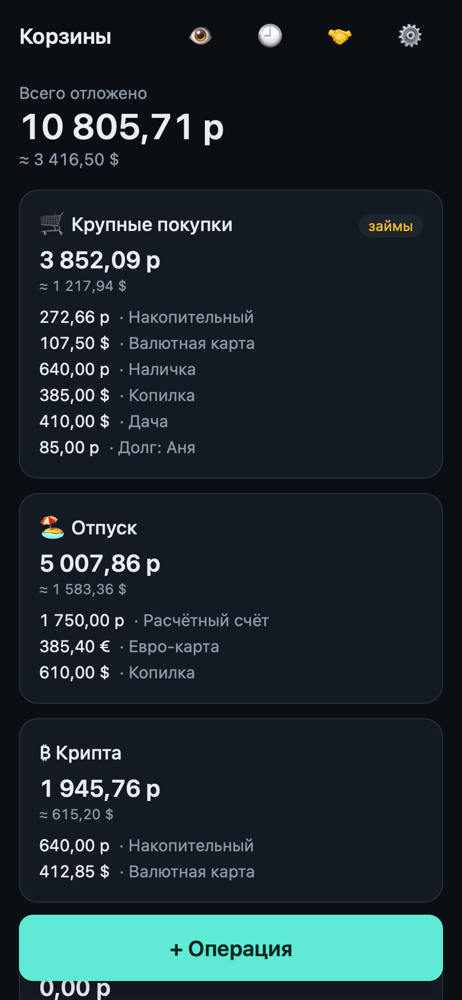
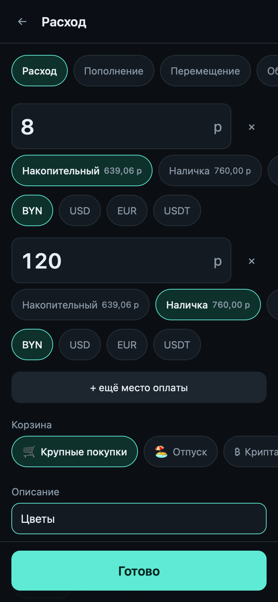
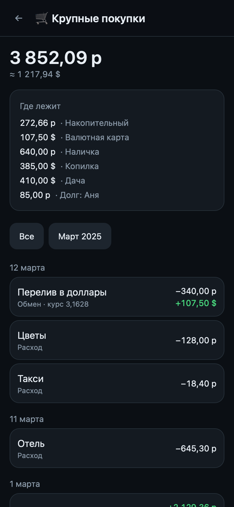

# MoneyBasket

**An offline-first PWA for tracking savings buckets** — money set aside for goals (big purchases, vacation, crypto), spread across several banks, cards, cash and currencies. Everything is stored in the browser (IndexedDB); nothing is sent to a server.

I built it for myself and use it daily — it replaced my monthly notes on where the money is.

| Home | Quick entry | Bucket |
|:---:|:---:|:---:|
|  |  |  |

*Screenshots are taken on fictional data (`node tools/screenshots.mjs`).*

The UI is in Russian. Requirements live in [SPEC.md](SPEC.md) (also in Russian).

## Key engineering decisions

- **Integer minor units.** Money is stored and computed as integers (kopecks/cents) — no floats anywhere in storage or arithmetic. Parsing and formatting are isolated in `src/domain/money.ts`.
- **Balances are derived from the ledger — never stored.** A position (*bucket × location × currency*) is always a fold over entries, so editing or deleting an operation can't leave totals out of sync. Deletion is soft, so it can be undone.
- **Domain layer independent of React and Dexie.** `src/domain/` is pure functions (entries, holdings, validation, conversion, rates) and is covered entirely by tests that never touch the UI or the database.
- **Golden tests.** Realistic multi-currency scenarios (loans and repayments, currency exchange, split payments, counter-transfers between buckets) are replayed through the domain layer and checked to the last cent. Invariants — a move keeps one currency, an exchange has exactly two, a reallocation nets to zero per currency — are validated in the domain, not in the UI.
- **Playwright e2e.** Interactive flows run in WebKit with an iPhone profile; offline behaviour and the service worker are tested against the production build.
- **Safe with local-only data.** Versioned JSON export/import (`schemaVersion`), a backup reminder, `navigator.storage.persist()` and its status shown in settings. The only network call is fetching exchange rates from the National Bank of Belarus API, and the app degrades gracefully to the last saved or manually entered rate.

## Stack

Vite · React 19 · TypeScript (strict) · Tailwind CSS 4 · Dexie (IndexedDB) · `vite-plugin-pwa` · Vitest · Playwright

## Getting started

```bash
npm install
npm run dev        # dev server
npm test           # domain, golden and unit tests (Vitest)
npm run test:e2e   # browser scenarios (Playwright)
npm run build      # type check + production build into dist/
npm run preview    # serve the production build
```

E2E needs browsers installed once: `npx playwright install webkit chromium`.

## Project layout

```
src/
  domain/     pure functions: money, entries, holdings, validation, conversion, rates
  db/         Dexie schema, repositories, liveQuery hooks, export/import
  features/   screens: onboarding, home, entry, bucket, operations, loans, settings
  ui/         shared components
tools/       screenshots.mjs — regenerates the README screenshots on fictional data
tests/
  golden/     multi-currency scenarios checked to the cent
  unit/       money, conversion, backup, forms
  e2e/        Playwright
```

## What's implemented

Onboarding with opening balances, home screen, quick entry (expense with split payment, top-up, move, currency exchange, loan and repayment, hand-off to pocket money), bucket screen, loans screen, edit and soft-delete of operations, JSON export/import with a backup reminder, transfers between buckets with a counter-leg, distributing the "Unallocated" bucket, exchange rates, and an all-time operations feed with search and month filter.

Not done yet: salary allocation templates, an income journal, a monthly report with Markdown export, a storage-locations screen with reconciliation, withdrawal to crypto.

## How this was built

Built with AI assistance ([Claude Code](https://claude.com/claude-code)). The requirements, the domain model and the design decisions are mine; the AI helped write the implementation and tests under that direction.

The sample data in tests, seed presets and the spec is fictional.

---

# Русская версия

Личное PWA для учёта «корзин» — денег, отложенных под цели. Работает офлайн, данные лежат только в браузере (IndexedDB), на сервер ничего не уходит. Требования — в [SPEC.md](SPEC.md).

Два правила, на которых всё держится:

1. **Деньги — только целые числа в минорных единицах.** Никаких float в хранении и расчётах.
2. **Остатки не хранятся.** Позиция «корзина × место × валюта» всегда считается свёрткой проводок, поэтому правка и удаление операций не могут рассинхронизировать итоги.

Доменный слой не знает ни про React, ни про Dexie — его целиком покрывают тесты в `tests/`. Команды запуска — в разделе Getting started выше.

## Про хранение данных на iPhone

- Пользоваться нужно **установленной на домашний экран** версией: у вкладки Safari и у установленного приложения разные хранилища.
- Safari чистит данные сайтов, которыми долго не пользуются. Приложение при старте запрашивает `navigator.storage.persist()` и показывает статус в настройках, но гарантии это не даёт.
- Поэтому регулярно делайте экспорт в JSON. Если последний бэкап был больше недели назад, на главной появится напоминание.

Курсы тянутся с API Нацбанка (`api.nbrb.by`) — это единственный внешний запрос во всём приложении. Если API недоступен, приложение остаётся на последнем сохранённом курсе и предлагает ввести его руками. USDT приравнивается к доллару.
